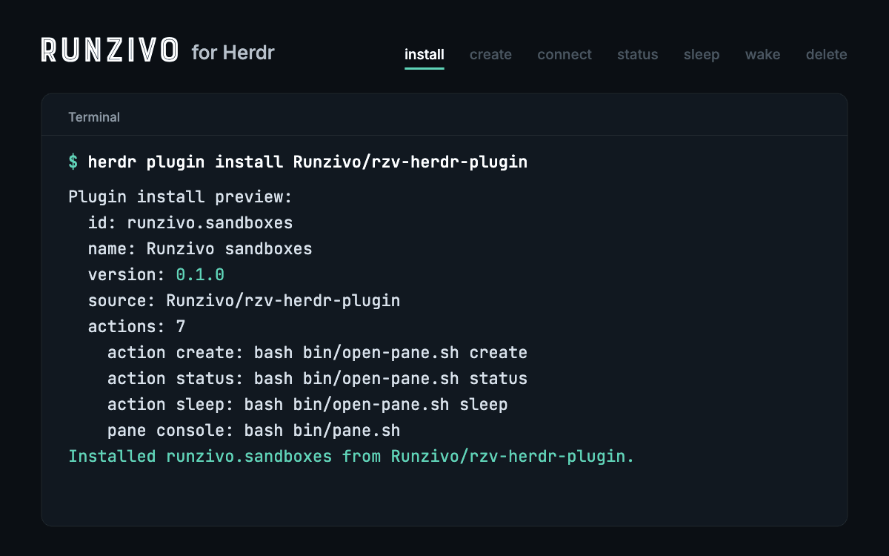

# Runzivo sandboxes for Herdr

Run [Herdr](https://herdr.dev) panes and coding agents in a
[Runzivo](https://runzivo.dev) cloud sandbox. The plugin creates a sandbox,
adds it to Herdr as a machine, and lets you check its cost, sleep it, wake it
and delete it without leaving Herdr.

[](https://github.com/Runzivo/rzv-herdr-plugin/actions/workflows/ci.yml) [](https://github.com/Runzivo/rzv-herdr-plugin/releases/latest) [](LICENSE) [](https://runzivo.dev/sandboxes/)



The plugin is a few Bash scripts that call the `rzv` CLI, OpenSSH and Herdr.
It stores no tokens, holds no AI provider keys and reads none of your code.

## Install

You need Herdr 0.9.5 or newer on macOS or Linux, and `rzv` 0.26.0 or newer.

Install Herdr first. On macOS, run `brew install herdr`. On Linux, or if you
don't use Homebrew, follow the
[Herdr install guide](https://herdr.dev/tui/docs/install/).

Then install `rzv`, sign in and add the plugin:

```sh
curl -fsSL https://runzivo.dev/downloads/rzv/install.sh | sh
rzv login
herdr plugin install Runzivo/rzv-herdr-plugin
```

Herdr shows the plugin's manifest and commands before it installs. Add
`--ref v0.1.0` to pin this release.

## Use

Open Herdr's command palette and pick a `Runzivo:` action:

| Action | What it does |
| --- | --- |
| create a sandbox machine | Creates `herdr-<name>`, sets up SSH, adds it to the sidebar |
| attach a sandbox machine | Wakes it if asleep and starts its Herdr server |
| sandbox status and cost | Status, expiry, time left, runtime and credits used |
| list sandboxes | Every sandbox in your workspace |
| sleep a sandbox | Stops it; compute billing stops |
| wake a sandbox | Starts it and reconnects the machine |
| delete a sandbox | Asks you to type its name, then deletes it and the machine |

Each action opens a small Runzivo pane for its questions and output.

## Docs

- [Usage and options](docs/usage.md)
- [Sleep, wake and what is kept](docs/lifecycle.md)
- [Errors and fixes](docs/troubleshooting.md)
- [Security](docs/security.md)
- [Testing and releasing](docs/testing.md)

MIT licensed. Herdr is a separate Apache-2.0 project; this plugin is not made
or reviewed by Herdr.
